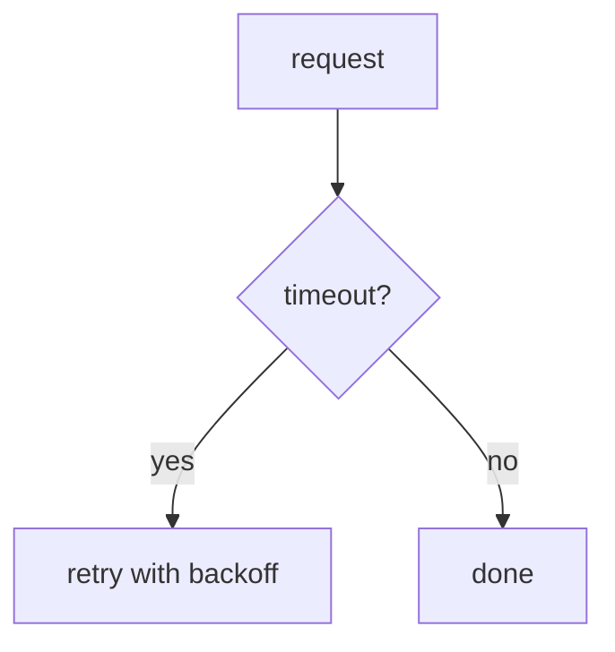

## you · t1
Compare these retry strategies for the auth timeout:

| strategy | retries | backoff | p99 latency |
|---|---|---|---|
| none | 0 | - | 30s |
| fixed | 3 | 1s | 12s |
| exponential | 5 | 2^n | 8s |

Which one should we ship?
END

## agent · t2
Exponential backoff wins on latency. Let me check the call sites first.

▸ grep -rn refresh_token src/
    001  src/auth/session.py:3: refresh_token() called without timeout
    002  src/auth/session.py:6: refresh_token() called without timeout
    003  src/auth/session.py:9: refresh_token() called without timeout
    004  src/auth/session.py:12: refresh_token() called without timeout
    005  src/auth/session.py:15: refresh_token() called without timeout
    006  src/auth/session.py:18: refresh_token() called without timeout
    007  src/auth/session.py:21: refresh_token() called without timeout
    008  src/auth/session.py:24: refresh_token() called without timeout
    009  src/auth/session.py:27: refresh_token() called without timeout
    010  src/auth/session.py:30: refresh_token() called without timeout
    011  src/auth/session.py:33: refresh_token() called without timeout
    012  src/auth/session.py:36: refresh_token() called without timeout
    013  src/auth/session.py:39: refresh_token() called without timeout
    014  src/auth/session.py:42: refresh_token() called without timeout
    015  src/auth/session.py:45: refresh_token() called without timeout
    016  src/auth/session.py:48: refresh_token() called without timeout
    017  src/auth/session.py:51: refresh_token() called without timeout
    018  src/auth/session.py:54: refresh_token() called without timeout
    019  src/auth/session.py:57: refresh_token() called without timeout
    020  src/auth/session.py:60: refresh_token() called without timeout
    021  src/auth/session.py:63: refresh_token() called without timeout
    022  src/auth/session.py:66: refresh_token() called without timeout
    023  src/auth/session.py:69: refresh_token() called without timeout
    024  src/auth/session.py:72: refresh_token() called without timeout
    025  src/auth/session.py:75: refresh_token() called without timeout
    026  src/auth/session.py:78: refresh_token() called without timeout
    027  src/auth/session.py:81: refresh_token() called without timeout
    028  src/auth/session.py:84: refresh_token() called without timeout
    029  src/auth/session.py:87: refresh_token() called without timeout
    030  src/auth/session.py:90: refresh_token() called without timeout
    031  src/auth/session.py:93: refresh_token() called without timeout
    032  src/auth/session.py:96: refresh_token() called without timeout
    033  src/auth/session.py:99: refresh_token() called without timeout
    034  src/auth/session.py:102: refresh_token() called without timeout
    035  src/auth/session.py:105: refresh_token() called without timeout
    036  src/auth/session.py:108: refresh_token() called without timeout
    037  src/auth/session.py:111: refresh_token() called without timeout
    038  src/auth/session.py:114: refresh_token() called without timeout
    039  src/auth/session.py:117: refresh_token() called without timeout
    040  src/auth/session.py:120: refresh_token() called without timeout

Here is the data as a chart and a table:

```chart
type: bar
labels: [none, fixed, exponential]
values: [30, 12, 8]
```

```csv
strategy,p99
none,30
fixed,12
exponential,8
```



A fake marker inside a code fence must not end the turn:

```text
END
## you · t99
```

An escaped marker line, shown literally:

\END
END

## you · t3
Try the interrupted case.
END

## agent · t4
Started answering and was cut
END (interrupted)

## you · t5
Now a failure.
END

## agent · t6
partial output
! error: daily spend cap reached ($5.00)
END (failed)

## you · t7
This is a draft without END, still being written.
