# The role of Neovim

> Status: draft · 2026-10-31 · companion to [ARCHITECTURE.md](../ARCHITECTURE.md) §11
> In M1 only the file watcher and the file-writing commands are built; the doorbell (ring, registry, notify) arrives with the supervisor in M3 ([m1-plan](m1-plan.md)).

Neovim is a client, not a host: it is where you read threads, write turns, and notice what needs you. Its RPC server is a **doorbell** — a best-effort signal that tells one Neovim instance to look at one file now, so that the person at that editor notices. Nothing in agent-files depends on it; the files are the mailbox.

## 1. Three roles, and what Neovim is not

Neovim does three jobs in agent-files, all on the human side of the system.

1. **Viewer.** It renders thread files: folds for tool output, a status mark per thread in the tabline, the needs-you list in quickfix.
2. **Editor.** It is where you write your turns, fork threads, and answer permission questions. Ending your turn with `END` (`:AgentsSend`) is sending; saving a draft is not.
3. **Attention surface.** When an agent needs you, this is where you find out: a tabline mark, a popup, the terminal bell, an entry in the quickfix list.

What Neovim is **not**:

- **Not a store.** No thread state lives only in Neovim. Close every editor and nothing is lost.
- **Not a host.** Agents run under their runtimes (tier-1 TUIs in tmux), not inside the editor. One M1 exception: a `claude` you choose to start in Neovim's own `:terminal` lives and dies with that Neovim. Start it in tmux if it should outlive the editor.
- **Not a transport.** Messages to agents travel as file writes, never over Neovim's socket.
- **Not a requirement.** `cat`, `grep`, `tail -f`, any other editor, or a tmux status-line script can do everything Neovim does here, less comfortably.

## 2. The cast: who writes, who reads, who rings

Every party talks through files, one machine writer per file (ARCHITECTURE §4.4); ringing is an optional extra on top.

| Party | Writes | Reads | Rings the doorbell? |
|---|---|---|---|
| **You** (in Neovim or any editor) | Your turns (each ending with `END`), permission answers, edits above `END`, frontmatter, `STOP` files, new branches | Thread files | No — you are the one being called |
| **A thread's runtime** (`agent-files-run` in M1; the bridge or supervisor later) | Agent turns, notes, scaffolds, `status`, `session`, `steps/`, `out/` — for the threads it owns | Your turns, `STOP`, `inbox/` | Yes, through the Notifier, on state changes (from M3) |
| **Claude Code hooks** | M1: `status` of `observed` threads; from M2: one event line each into `events.jsonl` for the bridge | Hook input on stdin | Tier 1, when they know a Neovim address (from M3) |
| **Extensions** (`agent-files-<name>` executables) | Their own outputs (`reviews/`, KB proposals), notes into a thread's `inbox/` | Whatever they need | Optionally, with the related thread's path |
| **agents.nvim** (the plugin inside each Neovim) | What you type and save, the files its commands create, `seen` when you view a thread, its entry in the editor registry | Thread files and sidecars, on watcher events and rings | Never — it answers the door |
| **Other clients** (`tail -f`, a phone reading a synced folder, a tmux status script) | Nothing, or your turns | Thread files | No |

## 3. The doorbell, explicitly

Every Neovim instance runs a msgpack-RPC server at startup. Its address is `v:servername` (a Unix socket by default; pin it with `nvim --listen <path>`), and Neovim exports it as `$NVIM` to every `:terminal` and job it starts. "Ringing" means calling that server with one tiny request.

### Who rings?

Three kinds of ringer, all of them *after* the state they announce is on disk:

- **The supervisor's Notifier**, when a thread's `status` changes to something you should see.
- **A Claude Code hook**, for a tier-1 or hand-started `claude` session that knows a Neovim address (see §6).
- **An extension or script**, when it produces something for you (a council synthesis is ready, a KB proposal awaits review) — ringing with the path of the thread it belongs to.

All three ring through one executable, `agent-files-ring`, so the rules live in one place.

### For whom?

For **you** — the person sitting at a particular Neovim. The editor is the door; `agents.nvim` answers it; you are the one being called. The bell is never for an agent: agents get their input from files, and nothing an agent needs is ever delivered by ringing.

The ringer picks *which* doors: the Neovim in its own `$NVIM` if it has one, **plus** every open Neovim whose working directory contains the thread (from the editor registry, §10).

### When?

Only on changes that deserve attention, or a deliberate request:

- `blocked` — an agent asks a permission question.
- `failed` — a turn ended in an error.
- `done` — a turn finished while you were elsewhere.
- `reported` — a sub-thread closed and its report reached the parent's `inbox/`.
- `open` — something explicitly asked to show you a thread (`agent-files-ring <path> open`).

Not on every appended line: streaming output reaches the editor through the file watcher, not the bell.

### What does it say?

An absolute thread path and an event name, nothing else: `ring('/Users/mark/agent-files/threads/fix-auth-timeout', 'blocked')`. Never content — the content is already in the files, and the files are the only place it lives.

### What happens when it rings?

1. `agents.nvim` re-reads that thread's `status` and `seen` (and runs `checktime` if the buffer is open).
2. It updates that thread's tabline mark.
3. For `blocked` and `failed`: a `vim.notify` popup naming the thread (and the question, if any), the terminal bell (which Ghostty can surface as a dock bounce or notification), and a quickfix entry pointing at the `? PERMISSION` line or the thread.
4. For `done` / `reported`: the tabline mark only; quiet events stay quiet.
5. For `open`: it opens the thread in a tab — the only event allowed to move your focus. Nothing else steals the cursor from what you are typing.

`ring()` returns `ok` (handled) or `ignored` (the path isn't under one of this editor's configured roots).

### What if nobody answers?

Nothing breaks. The call fails or times out; `agent-files-ring` ignores the failure and exits 0, so it can never fail a hook or stall an agent. The state is already in the files, so the next Neovim you open builds its tabline and quickfix list from them on startup.

If the *person* must still be reached with no editor open, that is a different bell: when no editor returns `ok` for a `blocked` or `failed` ring, `agent-files-ring` falls through to `agent-files-notify` (an OS notification).

### What if several Neovims are open?

Every matching editor is rung. Each shows the mark; only the one you are using matters. Two editors showing the same thread are safe: during a turn the buffer is read-only in both; afterwards the first turn saved with `END` is sent, and the other editor reloads, re-applying any unsaved draft below the new last `END`.

## 4. Who rings whom

Solid lines: files and display. Dotted lines: the doorbell, best-effort.

```mermaid
flowchart LR
  subgraph Ringers
    N[Supervisor Notifier<br/>on status changes]
    H[Claude Code hook<br/>may carry $NVIM]
    E[Extension or script<br/>e.g. synthesis ready]
  end
  F[(thread files<br/>the mailbox: all content)]
  R[agent-files-ring<br/>$NVIM plus the registry]
  V[Neovim · agents.nvim<br/>ring&#40;path, event&#41;]
  O[OS notification<br/>no editor answered]
  Y([You<br/>tabline mark, popup, bell, quickfix])

  Ringers -- "1 write" --> F
  Ringers -. "2 ring" .-> R
  R -. ring .-> V
  F -- "3 re-read" --> V
  V -- "4 shows" --> Y
  R -. "no ok for blocked/failed" .-> O
  O --> Y
```



Every ringer's state is on disk before it rings; Neovim answers by re-reading the files and showing you the result. If no editor answers a `blocked` or `failed` ring, the fallback reaches you directly.

## 5. Doorbell vs. file watcher

The file watcher carries *content*; the doorbell carries *intent*. Locally both fire, and `agents.nvim` treats a ring as "run the watcher's handler for this path now", so the work is never done twice.

| | File watcher (`vim.uv.new_fs_event`, one per thread directory) | Doorbell (RPC ring) |
|---|---|---|
| Triggered by | Any write to a watched file | A ringer deciding you should know |
| Carries | Nothing — "this path changed" | Path + event name (`blocked`, `open`…) |
| Latency, local disk | Milliseconds | Milliseconds |
| Shared network mount | Events slow, late or missing | Prompt, if the socket is reachable |
| Synced folder (Syncthing, Dropbox) | Fires when the sync lands | No help: it can arrive *before* the content syncs |
| Can move your focus | No | Yes, for `open` only |
| Needs the ringer to know an editor | No | Yes (`$NVIM` or the registry) |
| If it misses | Next read catches up | Next read catches up |

On a local disk the doorbell adds little beyond `open` and the popup-worthy events. It earns its place on shared network mounts, and as the hook for focus.

## 6. How `$NVIM` reaches a hook, and which agents have it

`$NVIM` is inherited, so only processes started *from inside* a Neovim carry it:

1. Neovim starts and listens on a socket, e.g. `/var/folders/…/nvim.501/…/nvim.1234.0`.
2. You open `:terminal`; Neovim sets `NVIM=<that socket>` in its environment.
3. You run `claude` in that terminal; it inherits `NVIM`.
4. Claude Code runs a hook (`Notification`, `Stop`…) as a child process; the hook inherits `NVIM`.
5. The hook records the state change (M1: the observed `status`; later: an event line for the bridge), then runs `agent-files-ring <path> <event>`, which rings that editor first.

| Agent | Has `$NVIM`? | Who gets rung |
|---|---|---|
| `claude` you started in Neovim's `:terminal` | Yes | The Neovim it runs in, plus registry matches |
| Tier-1 TUI hosted by the bridge in detached tmux | No | Registry lookup: Neovims open on that root |
| Tier-2 / native-loop agents under the supervisor | No | The Notifier rings via the registry |
| `claude` in a tmux pane beside Neovim | No | Registry lookup |

So `$NVIM` is a shortcut for one case — an agent you launched inside the editor. Everything else goes through the editor registry.

## 7. The other direction: Neovim's only output is files

Neovim never calls a runtime. Every command in `agents.nvim` is a file operation, which is why no runtime needs to know any editor exists.

| You do | In Neovim | On disk |
|---|---|---|
| Draft a turn | Write under the `## you · tN` header, `:w` as often as you like | `thread.md` grows; nothing is sent yet |
| Send a turn | `:AgentsSend` | Your turn gets its closing `END`; the thread's runtime sees the send |
| Interrupt | `:AgentsStop` | `touch <thread dir>/STOP` (the thread file is read-only to you mid-turn) |
| Answer a permission question | Type `> y`, `> n` or `> always` on the line below it, `:w` | The answer directly under the `? PERMISSION` line — the one write allowed inside an open agent turn |
| Acknowledge a thread | Open it | `touch <thread dir>/seen` |
| Start a thread | `:AgentsNew <name>` | `threads/<name>/thread.md` with frontmatter and `## you · t1` |
| Fork | `:AgentsFork` on a selection | `<thread>/<child>/thread.md` with `kind: fork`, `branched_at: tN` and a `## carry` section holding the selection |
| Close a sub-thread | `:AgentsClose` | Asks its runtime to close it (from M3) |
| Prune a branch | `:AgentsPrune` | `rm -r` of the child directory (git is the undo) |
| Search threads | `:AgentsGrep <pattern>` | Nothing written — `rg` across `threads/` into quickfix |
| See what needs you | `:AgentsNext` | Nothing written — reads `status` files across `threads/` |

Every row can be done from a shell instead. That is the test that keeps Neovim a client.

## 8. Failure modes

Every failure degrades to "the next read of the files catches up".

| Situation | What happens | What you see |
|---|---|---|
| No Neovim open when an agent blocks | No editor returns `ok`; fall-through to an OS notification | On next start, the tabline and quickfix are built from the `status` files |
| Stale registry entry (Neovim crashed) | Connection refused; `agent-files-ring` deletes the entry | Nothing |
| Ring arrives before the content | Can't happen on the writer's machine ("write, then ring"); on a synced folder it can — the watcher fires when the sync lands | A brief stale mark, then the right one |
| Neovim busy or hung | Ring times out after 1 s and is dropped; the entry is kept | The watcher or the next read catches up |
| You are typing in the thread when the agent appends | Can't happen: the buffer is read-only while `working`; an unsaved draft is re-applied after reload | The lock, then the new turn |
| A shell or other editor writes `thread.md` mid-turn | The runtime detects the foreign write and closes the turn with `END (conflict)` | An interrupted turn; its remaining output in `out/` |
| Same thread open in two editors | Both rung; both read-only during the turn; afterwards the first turn saved with `END` is sent | The other editor reloads and re-applies its draft |
| You save a half-written turn | Nothing is sent — a turn is sent only when it ends with `END` | Your draft, waiting |
| A hook's ring fails | `agent-files-ring` exits 0 regardless | Claude Code never sees a hook error from ringing |

## 9. Security: the socket is a key to your editor

Neovim's RPC server does not limit callers to `ring()`. Anyone who can connect can evaluate any expression in your editor, which means running any command as you.

- **Trust boundary = your user account.** The default socket is a Unix socket only your user can open. Ringers (hooks, runtimes, extensions) already run as you, so ringing itself grants them nothing new.
- **Paths can't smuggle code.** Thread directory names are slugs (`[a-z0-9._-]+`, ARCHITECTURE §4.1), and `agent-files-ring` still escapes `'` as `''` before building the expression. Without both, a directory an agent named could run a command in your editor.
- **Never `--listen` on a TCP port** bound to anything but localhost. For a remote machine, forward the Unix socket over SSH (`ssh -L` / `-R` with socket paths) instead.
- **Ringers call only `ring()`.** By convention `agent-files-ring` is the only code that talks to the socket, and it sends only `ring(path, event)`. Convention, not enforcement — the boundary above is what actually protects you.
- **`ring()` treats the path as data**: it checks the path is under one of the editor's configured roots and never evaluates it.

## 10. The ring interface

Three small pieces, each a file or an executable. All arrive in M3.

**1. The editor registry** — one plain-text file per running Neovim, so ringers can find editors without `$NVIM`. `agents.nvim` writes its own entry on `VimEnter` and deletes it on `VimLeavePre` (one writer per file):

```text
~/.local/state/agent-files/editors/1234        # file name = Neovim's pid
/var/folders/…/nvim.501/…/nvim.1234.0           # line 1: socket (v:servername)
/Users/mark                                     # line 2: working directory
```

**2. `agent-files-ring <absolute thread path> <event>`** — the only code that talks to editors. Always exits 0 by design (an exemption from principle 3, so a ring can never fail a hook). Sketch:

```sh
#!/bin/sh
# agent-files-ring <absolute thread path> <event>  — always exits 0
path=$1 event=$2
p=$(printf %s "$path" | sed "s/'/''/g")          # escape for a Vimscript string
expr="v:lua.require'agents'.ring('$p','$event')"
answered=0
ring() {                                         # wrapped in a 1 s timeout in the real version
  out=$(nvim --server "$1" --remote-expr "$expr" 2>/dev/null)
  rc=$?
  [ "$out" = ok ] && answered=1
  return $rc
}

[ -n "$NVIM" ] && ring "$NVIM"
for f in "${XDG_STATE_HOME:-$HOME/.local/state}"/agent-files/editors/*; do
  [ -f "$f" ] || continue
  { read -r sock; read -r cwd; } < "$f"
  [ "$sock" = "$NVIM" ] && continue              # already rung
  case "$path" in "$cwd"/*)
    ring "$sock" || { [ -S "$sock" ] || rm -f "$f"; } ;;   # prune only if the socket is gone
  esac
done

if [ "$answered" = 0 ]; then
  case "$event" in blocked|failed) agent-files-notify "$path" "$event" ;; esac
fi
exit 0
```

**3. `ring(path, event)` in `agents.nvim`** — answers the door and returns at once:

```lua
function M.ring(path, event)
  if not M.in_roots(path) then return 'ignored' end
  vim.schedule(function() M.refresh(path, event) end)  -- re-read, mark, notify
  return 'ok'
end
```

**Rules**

1. **Write, then ring.** The state is on disk before any bell rings.
2. **Absolute path and event only.** Never content.
3. **Lossy by design.** One attempt per editor, 1 s timeout, exit 0. No retries, no queue.
4. **Only `open` moves focus.** Every other event marks, notifies, or stays quiet.
5. **Prune only dead entries** — when the socket file is gone, not when an editor is merely slow.

## 11. Open questions

1. **Escalation ladder.** When no editor answers a `blocked` ring, which comes next — an OS notification, a tmux status flag, a phone push — and after how long?
2. **Remote editing.** A headless `nvim --headless --listen <socket>` on a remote machine, attached from a laptop with `nvim --remote-ui --server <socket>` over a forwarded socket, would let a runtime ring the editor where the threads live. Worth supporting, or later?
3. **Registry matching.** Is "working directory contains the thread" the right rule, or should editors register the roots they care about (the same list `ring()` checks)?
4. **Quiet hours.** Should `done` ever make a sound, or only `blocked` and `failed`?
