# The role of Neovim

> Status: draft · 2026-10-31 · companion to [ARCHITECTURE.md](../ARCHITECTURE.md) §10

Neovim is a client, not a host: it is where you read threads, write turns, and notice what needs you. Its RPC server is a **doorbell** — a best-effort signal that tells one Neovim instance to look at one file now, so that the person at that editor notices. Nothing in agent-files depends on it; the files are the mailbox.

## 1. Three roles, and what Neovim is not

Neovim does three jobs in agent-files, all on the human side of the system.

1. **Viewer.** It renders thread files: folds for tool calls, a status mark per thread in the tabline, the needs-you list in quickfix.
2. **Editor.** It is where you write your turns below `END`, fork threads, and answer permission questions. Saving the file is sending.
3. **Attention surface.** When an agent needs you, this is where you find out: a tabline mark, a popup, the terminal bell, an entry in the quickfix list.

What Neovim is **not**:

- **Not a store.** No thread state lives only in Neovim. Close every editor and nothing is lost.
- **Not a host.** Agents run under the supervisor (and tier-1 TUIs in tmux), not inside the editor.
- **Not a transport.** Messages to agents travel as file writes, never over Neovim's socket.
- **Not a requirement.** `cat`, `grep`, `tail -f`, any other editor, or a tmux status-line script can do everything Neovim does here, less comfortably.

## 2. The cast: who writes, who reads, who rings

Every party talks through files; ringing is an optional extra on top.

| Party | Writes | Reads | Rings the doorbell? |
|---|---|---|---|
| **You** (in Neovim or any editor) | Your turns below `END`, `STOP`, permission answers, new thread directories | Thread files | No — you are the one being called |
| **Supervisor** (Elixir, one ThreadServer per thread) | Agent turns, `status:` changes, child reports, steps | Your turns, `STOP` lines | Yes, through its Notifier, on state changes |
| **Claude Code hooks** (tier-1 and hand-started `claude` sessions) | `status:` changes | Hook input on stdin | Yes, when they have a Neovim address |
| **Extensions** (`agent-files-<name>` executables) | Whatever their job is (reviews, KB proposals) | Whatever they need | Optionally, when they produce something for you |
| **agents.nvim** (the plugin inside each Neovim) | Only what you type and save | Thread files, on watcher events and rings | Never — it answers the door |
| **Other clients** (`tail -f`, a phone reading a synced folder, a tmux status script) | Nothing, or your turns | Thread files | No |

## 3. The doorbell, explicitly

Every Neovim instance runs a msgpack-RPC server at startup. Its address is `v:servername` (a Unix socket by default; pin it with `nvim --listen <path>`), and Neovim exports it as `$NVIM` to every `:terminal` and job it starts. "Ringing" means calling that server with one tiny request.

### Who rings?

Three kinds of ringer, all of them *after* they have written to a file:

- **The supervisor's Notifier**, when a ThreadServer changes a thread's `status:` to something you should see.
- **A Claude Code hook**, for a `claude` session that knows a Neovim address (see §6).
- **An extension or script**, when it produces something for you (a council synthesis is ready, a KB proposal awaits review).

All three ring through one executable, `agent-files-ring`, so the rules live in one place.

### For whom?

For **you** — the person sitting at a particular Neovim. The editor is the door; `agents.nvim` answers it; you are the one being called. The bell is never for an agent: agents get their input from files, and nothing an agent needs is ever delivered by ringing.

The ringer picks *which* door: the Neovim in its own `$NVIM` if it has one, otherwise every open Neovim whose working directory contains the thread (from the editor registry, §9).

### When?

Only on changes that deserve attention, or a deliberate request:

- `blocked` — an agent asks a permission question or waits for you.
- `done` — a turn finished while you were elsewhere.
- `reported` — a sub-thread appended its result to a parent.
- `open` — something explicitly asked to show you a thread (`agent-files-ring <path> open`).
- `changed` — a catch-all for clients without a working file watcher.

Not on every appended line: streaming output reaches the editor through the file watcher, not the bell.

### What does it say?

A path and an event name, nothing else: `ring('threads/fix-auth-timeout/thread.md', 'blocked')`. Never content — the content is already in the file, and the file is the only place it lives.

### What happens when it rings?

1. `agents.nvim` re-reads that thread's frontmatter (and runs `checktime` if the buffer is open).
2. It updates that thread's tabline mark.
3. For `blocked`: a `vim.notify` popup naming the thread and question, the terminal bell (which Ghostty can surface as a dock bounce or notification), and a quickfix entry pointing at the question line.
4. For `done` / `reported`: the tabline mark only; quiet events stay quiet.
5. For `open`: it opens the thread in a tab — the only event allowed to move your focus. Nothing else steals the cursor from what you are typing.

### What if nobody answers?

Nothing breaks. The call fails or times out; `agent-files-ring` ignores the failure and exits 0, so it can never fail a hook or stall an agent. The state is already in the file, so the next Neovim you open builds its tabline and quickfix list from the files on startup.

If the *person* must still be reached with no editor open, that is a different bell: an escalation step (an `agent-files-notify` extension sending an OS notification) that `agent-files-ring` can fall through to when no editor answers a `blocked` event.

### What if several Neovims are open?

Each registered instance whose working directory contains the thread is rung. Each shows the mark; only the one you are using matters. Two editors showing the same thread are safe: during a turn the buffer is read-only in both, and after `END` whichever saves first sends; the other reloads.

## 4. Who rings whom

Solid lines: files and display. Dotted lines: the doorbell, best-effort.

```mermaid
flowchart LR
  subgraph Ringers
    N[Supervisor Notifier<br/>on status changes]
    H[Claude Code hook<br/>may carry $NVIM]
    E[Extension or script<br/>e.g. synthesis ready]
  end
  F[(thread.md<br/>the mailbox: all content)]
  R[agent-files-ring<br/>$NVIM, else the registry]
  V[Neovim · agents.nvim<br/>ring&#40;path, event&#41;]
  O[OS notification<br/>fallback for blocked]
  Y([You<br/>tabline mark, popup, bell, quickfix])

  Ringers -- "1 write" --> F
  Ringers -. "2 ring" .-> R
  R -. ring .-> V
  F -- "3 re-read" --> V
  V -- "4 shows" --> Y
  R -. "no editor answered" .-> O
  O --> Y
```



Every ringer writes the thread file first, then rings; Neovim answers by re-reading that file and showing you the result. If no editor answers a `blocked` ring, the fallback reaches you directly.

## 5. Doorbell vs. file watcher

The file watcher carries *content*; the doorbell carries *intent*. Locally both fire, and `agents.nvim` treats a ring as "run the watcher's handler for this path now", so the work is never done twice.

| | File watcher (`vim.uv.new_fs_event`) | Doorbell (RPC ring) |
|---|---|---|
| Triggered by | Any write to a watched file | A ringer deciding you should know |
| Carries | Nothing — "this path changed" | Path + event name (`blocked`, `open`…) |
| Latency, local disk | Milliseconds | Milliseconds |
| Network mounts, synced folders | Events slow, late or missing | Works if the socket is reachable |
| Can move your focus | No | Yes, for `open` only |
| Needs the ringer to know an editor | No | Yes (`$NVIM` or the registry) |
| If it misses | Next read catches up | Next read catches up |

On a local disk the doorbell adds little beyond `open` and the popup-worthy events. It earns its place on filesystems where change events don't arrive, and as the hook for focus.

## 6. How `$NVIM` reaches a hook, and which agents have it

`$NVIM` is inherited, so only processes started *from inside* a Neovim carry it:

1. Neovim starts and listens on a socket, e.g. `/var/folders/…/nvim.501/…/nvim.1234.0`.
2. You open `:terminal`; Neovim sets `NVIM=<that socket>` in its environment.
3. You run `claude` in that terminal; it inherits `NVIM`.
4. Claude Code runs a hook (`Notification`, `Stop`…) as a child process; the hook inherits `NVIM`.
5. The hook writes `status:` to the thread file, then runs `agent-files-ring <path> blocked`, which sees `$NVIM` and rings exactly that editor.

| Agent | Has `$NVIM`? | Who gets rung |
|---|---|---|
| `claude` you started in Neovim's `:terminal` (M1, observe-only) | Yes | The Neovim it runs in |
| Tier-1 TUI hosted by the supervisor in detached tmux | No | Registry lookup: Neovims open on that project |
| Tier-2 / native-loop agents under the supervisor | No | The Notifier rings via the registry |
| `claude` in a tmux pane beside Neovim | No | Registry lookup |

So `$NVIM` is a shortcut for one case — an agent you launched inside the editor. Everything else goes through the editor registry.

## 7. The other direction: Neovim's only output is files

Neovim never calls the supervisor. Every command in `agents.nvim` is a file operation, which is why the supervisor doesn't need to know any editor exists.

| You do | In Neovim | On disk |
|---|---|---|
| Send a turn | Write below `END`, `:w` | `thread.md` grows; the supervisor's watcher picks it up |
| Interrupt | `:AgentsStop` | A `STOP` line below `END` |
| Answer a permission question | Type `y` / `n` / `always` under it, `:w` | The answer below the `? PERMISSION` block |
| Start a thread | `:AgentsNew <name>` | `threads/<name>/thread.md` with frontmatter |
| Fork or branch | `:AgentsFork` on a turn | `<thread>/<child>/thread.md` with `branched_at:` and a `carry:` block |
| Prune a branch | `:AgentsPrune` | `rm -r` of the child directory (git is the undo) |
| See what needs you | `:AgentsNext` | Nothing written — reads `status:` across `threads/` |

Every row can be done from a shell instead. That is the test that keeps Neovim a client.

## 8. Failure modes

Every failure degrades to "the next read of the file catches up".

| Situation | What happens | What you see |
|---|---|---|
| No Neovim open when an agent blocks | Ring finds no editor; optional fall-through to an OS notification | On next start, the tabline and quickfix are built from `status:` in the files |
| Stale registry entry (Neovim crashed) | Connection refused; `agent-files-ring` deletes the entry | Nothing |
| Ring arrives before the write lands | Can't happen if ringers follow "write, then ring"; if it does, the watcher fires a moment later | A brief stale mark, then the right one |
| Neovim busy or hung | Ring times out after 1 s and is dropped | The watcher or the next read catches up |
| You are typing in the thread when the agent appends | Can't happen: the buffer is read-only while `status: working` | The lock, then the new turn |
| Same thread open in two editors | Both rung; both read-only during the turn; after `END` the first save sends | The other editor reloads |
| Thread on a synced folder, events delayed | Watcher is late; the ring (if the socket is reachable) is not | Prompt mark via the ring |
| A hook's ring fails | `agent-files-ring` exits 0 regardless | Claude Code never sees a hook error from ringing |

## 9. Security: the socket is a key to your editor

Neovim's RPC server does not limit callers to `ring()`. Anyone who can connect can evaluate any expression in your editor, which means running any command as you.

- **Trust boundary = your user account.** The default socket is a Unix socket only your user can open. Ringers (hooks, the supervisor, extensions) already run as you, so ringing grants them nothing new.
- **Never `--listen` on a TCP port** bound to anything but localhost. For a remote machine, forward the Unix socket over SSH (`ssh -L` / `-R` with socket paths) instead.
- **Ringers call only `ring()`.** By convention `agent-files-ring` is the only code that talks to the socket, and it sends only `ring(path, event)`. Convention, not enforcement — the boundary above is what actually protects you.
- **Paths are data.** `ring()` checks the path is inside a registered `threads/` root and never evaluates it.

## 10. The ring interface

Three small pieces, each a file or an executable.

**1. The editor registry** — one plain-text file per running Neovim, so ringers can find editors without `$NVIM`. `agents.nvim` writes it on `VimEnter` and deletes it on `VimLeavePre`:

```text
~/.local/state/agent-files/editors/1234        # file name = Neovim's pid
/var/folders/…/nvim.501/…/nvim.1234.0           # line 1: socket (v:servername)
/Users/mark/dev/my-project                      # line 2: working directory
```

**2. `agent-files-ring <path> <event>`** — the only code that talks to editors (sketch):

```sh
#!/bin/sh
# agent-files-ring <thread path> <event>  — always exits 0
path=$1 event=$2
expr="v:lua.require'agents'.ring('$path','$event')"
ring() { nvim --server "$1" --remote-expr "$expr" >/dev/null 2>&1; }  # wrapped in a 1 s timeout

if [ -n "$NVIM" ]; then ring "$NVIM"; exit 0; fi
for f in "${XDG_STATE_HOME:-$HOME/.local/state}"/agent-files/editors/*; do
  { read -r sock; read -r cwd; } < "$f"
  case "$path" in "$cwd"/*) ring "$sock" || rm -f "$f" ;; esac
done
exit 0
```

**3. `ring(path, event)` in `agents.nvim`** — answers the door and returns at once:

```lua
function M.ring(path, event)
  if not M.in_roots(path) then return 'ignored' end
  vim.schedule(function() M.refresh(path, event) end)  -- re-read, mark, notify
  return 'ok'
end
```

**Rules**

1. **Write, then ring.** The file is updated before any bell rings.
2. **Path and event only.** Never content.
3. **Lossy by design.** One attempt, 1 s timeout, exit 0. No retries, no queue.
4. **Only `open` moves focus.** Every other event marks, notifies, or stays quiet.
5. **Stale entries are pruned by ringers** when a socket refuses.

## 11. Open questions

1. **Escalation ladder.** When no editor answers a `blocked` ring, which comes next — an OS notification, a tmux status flag, a phone push — and after how long?
2. **Remote editing.** A headless `nvim --headless --listen <socket>` on a remote machine, attached from a laptop with `nvim --remote-ui --server <socket>` over a forwarded socket, would let the supervisor ring the editor where the threads live. Worth supporting in M1, or later?
3. **Registry matching.** Is "working directory contains the thread" the right rule, or should editors register the `threads/` roots they care about?
4. **Quiet hours.** Should `done` ever make a sound, or only `blocked`?
